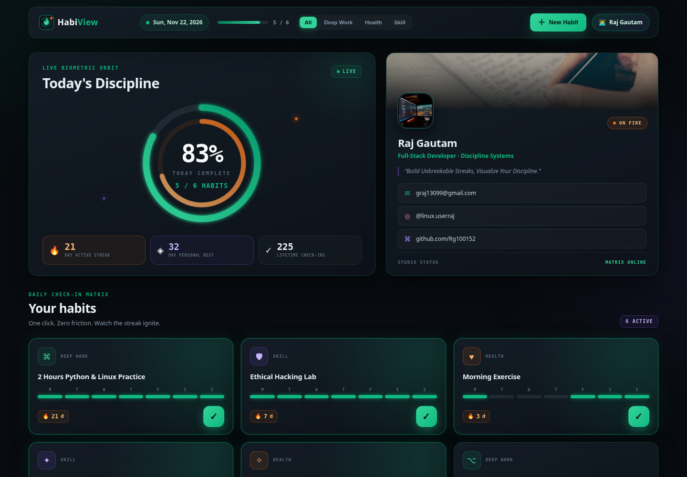
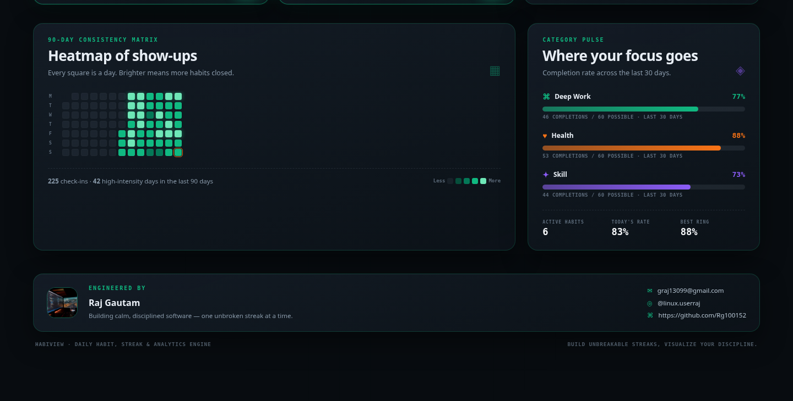
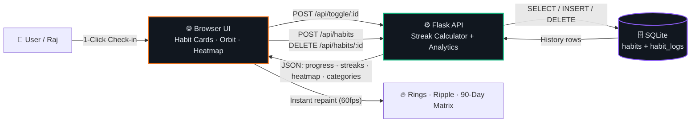
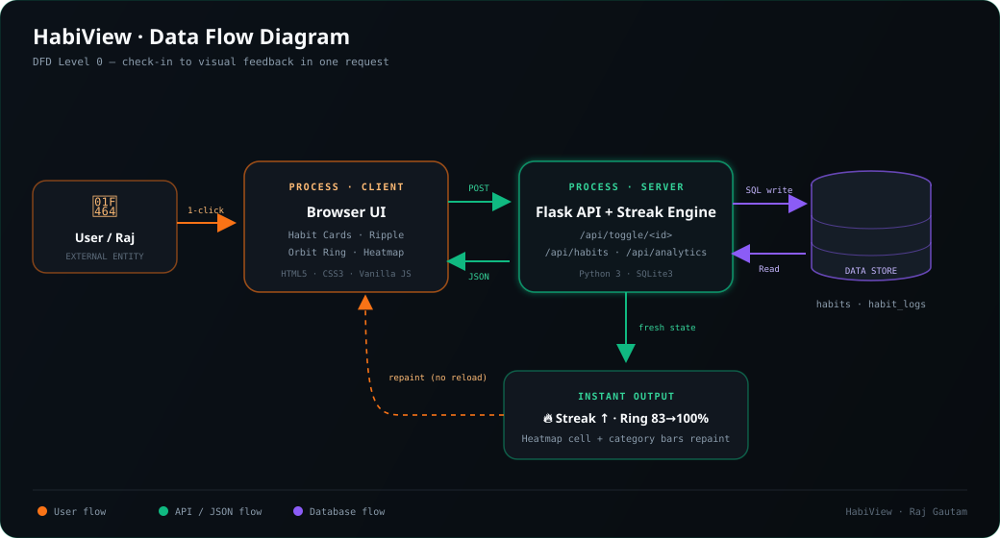

<div align="center">


<br>


<br>


# HabiView

**Build Unbreakable Streaks, Visualize Your Discipline.**

Daily Habit Tracker with a live Biometric Orbit, 90-day consistency heatmap and behavioral analytics.

Engineered by **[Raj Gautam](https://github.com/Rg100152)**


[](https://github.com/Rg100152/habivew/stargazers)
[](https://github.com/Rg100152/habivew/forks)
[](https://github.com/Rg100152/habivew/commits/main)

</div>

---

## ✨ What makes HabiView different

| Feature | What it does |
|---|---|
| 🟢 **Biometric Orbit Hero** | Dual animated SVG rings: outer = today's completion %, inner = live streak fire (pulsing orange glow). |
| ✅ **1-Click Ripple Check-in** | Tap a habit card button → emerald ripple + glow, SQLite write via Fetch API, **zero page reloads**. |
| 🔥 **Live Streak Engine** | Per-habit current & longest streaks recalculated on every check-in, plus a global active-streak counter. |
| ▦ **90-Day Consistency Heatmap** | GitHub-style intensity matrix with hover/focus tooltips showing date and daily score. |
| ◈ **Category Pulse** | Completion bars for Deep Work, Health and Skill over the last 30 days. |
| 🎛 **Focus Filter** | Instantly filter the habit matrix by All / Deep Work / Health / Skill. |
| ➕ **Add & Remove Habits** | Modal-driven creation and one-click removal — both synced to SQLite. |
| 🌙 **Zen-Botanical Obsidian UI** | `#080C10` canvas, `#11171F` glass cards, emerald/flame/violet accents, ambient glows, fully responsive. |

---

## 🖼 UI Showcase

| Biometric Orbit + Habit Matrix | 90-Day Heatmap + Category Analytics |
|:---:|:---:|
|  |  |

_Screenshots are captured from the real running app — not mockups._

---

## 🚀 Quick start

```bash
# 1. Clone & enter
git clone https://github.com/Rg100152/habivew.git
cd habivew

# 2. Virtual environment
python3 -m venv venv
source venv/bin/activate          # Windows: venv\Scripts\activate

# 3. Dependencies
pip install -r requirements.txt

# 4. Seed 6 habits + 45 days of history
python3 seed_habits.py

# 5. Run
python3 app.py
```

Open **http://127.0.0.1:5000** in your browser.

> 💡 Port 5000 busy? Run `PORT=5055 python3 app.py` and open `http://127.0.0.1:5055`.

The seed script creates `database/habiview.db` with 6 habits and 45 days of realistic logs — the heatmap, streaks and analytics are rich immediately (today starts at **5/6 = 83%** so you can try a check-in right away).

---

## 📁 Project structure

```text
habiview/
├── app.py                      # Flask server, streak calculator & analytics API
├── seed_habits.py              # 6 habits + 45 days of realistic check-in history
├── requirements.txt            # flask
├── README.md                   # This dynamic README
├── .gitignore
├── database/
│   ├── .gitkeep
│   └── habiview.db             # Generated locally (SQLite)
├── templates/
│   ├── base.html               # Glass command bar, logo, dev pill, modal, footer
│   └── index.html              # Orbit hero, habit matrix, heatmap, analytics
├── static/
│   ├── css/habiview.css        # Zen-Botanical Obsidian design system
│   ├── js/habiview.js          # Rings, check-in ripple, heatmap, filters, modal
│   └── assets/
│       ├── logo-habiview.svg   # Emerald flame + orbit wordmark
│       ├── favicon.svg
│       ├── banner.jpg
│       ├── avatar.jpg
│       ├── typing-badge.svg    # Animated typing badge used above
│       ├── screenshot-hero.png
│       └── screenshot-heatmap.png
└── docs/
    ├── dfd.svg                 # Downloadable Data Flow Diagram (SVG)
    ├── sdd.md                  # Software Design Document
    └── sdd-architecture.svg    # Downloadable architecture diagram (SVG)
```

---

## 🔌 API reference

| Method | Endpoint | Purpose |
|---|---|---|
| `GET` | `/` | Dashboard with server-rendered bootstrap data |
| `GET` | `/api/dashboard` | Full payload: habits, progress, summary, heatmap, categories |
| `GET` | `/api/analytics` | 90-day heatmap + category rates + summary |
| `POST` | `/api/toggle/<habit_id>` | Check in / uncheck today; recalculates every streak (optional `{"completed": true\|false}`) |
| `POST` | `/api/habits` | Create habit — `{"name", "category", "icon"}` |
| `DELETE` | `/api/habits/<habit_id>` | Remove a habit and its logs |

All mutations return the refreshed progress/summary/category data so the frontend can repaint in a single paint cycle — no reload, no extra round-trip.

---

## 🗄 Database model

```text
habits                       habit_logs
─────────────────────        ─────────────────────────────
id        INTEGER PK    ┌──── id         INTEGER PK
name      TEXT          │     habit_id   INTEGER FK → habits.id
category  TEXT          │     log_date   TEXT  (YYYY-MM-DD)
icon      TEXT          │     completed  INTEGER (0 | 1)
created_at TEXT         │     UNIQUE(habit_id, log_date)
                        └────
```

**Streak rule:** walk backwards from today; if today is still open, start at yesterday. Count consecutive completed days. Longest streak = maximum consecutive run across all history.

---

## 🔄 Data Flow Diagram (DFD)



<a href="docs/dfd.svg"></a>

📥 [Download the DFD as SVG](docs/dfd.svg) · 📐 [Read the full SDD](docs/sdd.md) · 🏗 [Architecture SVG](docs/sdd-architecture.svg)

---

## 👨‍💻 Developer

<div align="center">


**Raj Gautam** — Full-Stack Developer · Discipline Systems

[](mailto:graj13099@gmail.com)
[](https://www.instagram.com/linux.userraj/)
[](https://github.com/Rg100152)

> "Build Unbreakable Streaks, Visualize Your Discipline."

</div>

---

## 📄 License

MIT — build on it, break a streak, then rebuild it stronger. 🔥

<p align="center">Made with emerald, obsidian and a lot of discipline by <a href="https://github.com/Rg100152">Raj Gautam</a>.</p>
